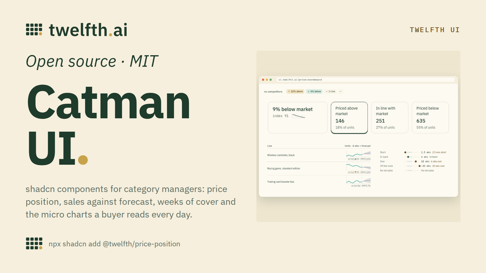

[](https://ui.twelfth.ai)

# Twelfth catman UI

Open-source [shadcn](https://ui.shadcn.com) components for category managers and
retail buying teams. These are the figures a buyer reads every day, in the words they read them in:
price position against a competitor, sales against forecast, weeks of cover,
pricing scoreboards, and the small charts and change indicators that fit in a
table cell.

**Docs, playgrounds and every variant: https://ui.twelfth.ai**

Built by [Twelfth](https://twelfth.ai) and taken from the product retail teams
use. MIT licensed.

## Install

Every block installs with the shadcn CLI and brings the pieces it builds on:

```sh
npx shadcn@latest add https://ui.twelfth.ai/r/price-position.json
npx shadcn@latest add https://ui.twelfth.ai/r/micro-trend.json
```

Or register the namespace once in `components.json`:

```json
{
  "registries": {
    "@twelfth": "https://ui.twelfth.ai/r/{name}.json"
  }
}
```

and then `npx shadcn@latest add @twelfth/price-position`.

Every block page on ui.twelfth.ai also opens straight in v0, Lovable, Bolt,
Claude, ChatGPT or Cursor.

## Blocks

| Block | What it is |
| --- | --- |
| [`price-position`](https://ui.twelfth.ai/price-position) | Our prices against one competitor: 12% above, 4% below, in line. As a chip, or a badge with the index and matched-line evidence on hover. |
| [`price-scoreboard`](https://ui.twelfth.ai/price-scoreboard) | The four numbers atop a pricing page: position vs market with its index and trend, then lines priced above, in line and below, optionally as filters. |
| [`price-trend`](https://ui.twelfth.ai/price-trend) | Weekly price position against the market as a small line with a parity line. |
| [`micro-trend`](https://ui.twelfth.ai/micro-trend) | One or more lines over time for a table cell: sales vs forecast with a P10–P90 band, this year vs last, stock vs the reorder point. |
| [`micro-stat`](https://ui.twelfth.ai/micro-stat) | A change toned by whether up is good or bad ("vs LY ▲6.2%", "MAPE ▲7 pts") and a labelled figure, each with a tooltip. |
| [`weeks-of-cover`](https://ui.twelfth.ai/weeks-of-cover) | Weeks of stock at the current rate of sale, on a track against the healthy band. |
| [`market-side`](https://ui.twelfth.ai/market-side) | The favourable / exposed tone the blocks share, its arrow, and the colour tokens behind it. |
| [`retail-format`](https://ui.twelfth.ai/retail-format) | Money, units, percent, price index and weeks, formatted for retail (en-AU by default). |
| [`one-open`](https://ui.twelfth.ai/one-open) | Keeps one hover card open at a time across a row of badges. |

Components are written for shadcn's Base UI styles (`base-nova` and friends)
and Tailwind v4. They take plain props and do no data fetching.

## Contributing

The components are written in Twelfth's main codebase and published to
https://ui.twelfth.ai on every deploy; this repository mirrors that registry
hourly (`scripts/sync.mjs`). Pull requests here are copied across by hand.
Issues and suggestions are welcome: open an issue, or write to hello@twelfth.ai.

## Licence

MIT © 2026 Twelfth AI Pty Ltd
